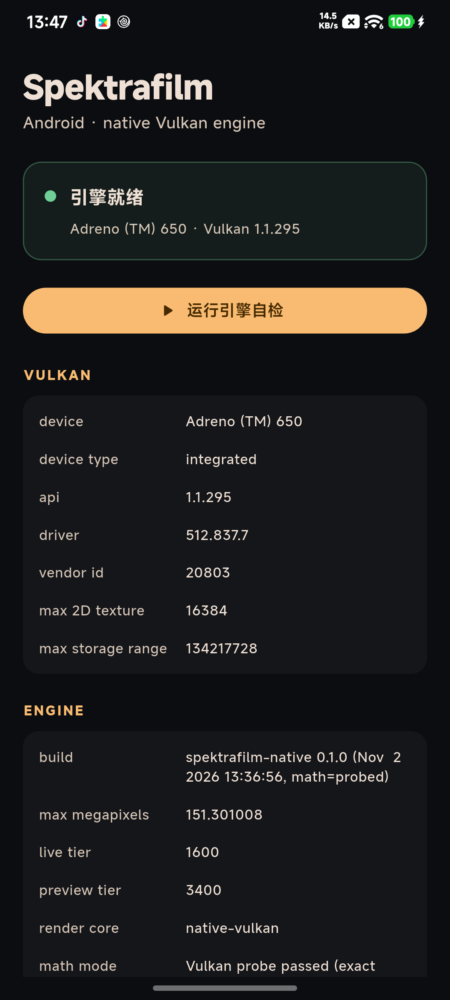

# Spektrafilm Mobile

Flutter 前端 + SpektraLab 的 C++20 / Vulkan 渲染引擎，通过 `dart:ffi` 直接跑在 Android 上。
没有 Python，没有服务端，没有 LUT 近似——光谱计算、coupler、颗粒、光晕都在手机 GPU 上算。



## 当前状态

已经把整条原生链路打通，并在这台机器上完成 release 构建：

- [x] NDK 编译 C++20 引擎（`libspektrafilm.so`，arm64-v8a）
- [x] 49 个 Vulkan compute shader 用 NDK 自带 `glslc` 编译成 SPIR-V
- [x] `volk` 在 Android 上加载 `libvulkan.so`
- [x] 引擎 math probe 通过（`math=probed`、`render_core=native-vulkan`）
- [x] 28 个胶片 profile + 相纸 + 打印 LUT 作为 assets 打包，首次启动解压到 `filesDir`
- [x] Flutter UI ↔ `dart:ffi` ↔ C ABI（参数走 JSON）
- [x] debug / release APK 都能在 Adreno 650 上启动并创建引擎
- [x] 两个导入入口：相册图片（Dart 解码 → 直送引擎）与 RAW（LibRaw）
- [x] RAW 解码（LibRaw 0.22.2，NDK/CMake 原生）
- [x] 常驻 engine + session（`EngineWorker`，后台 isolate）
- [x] `spk_set_params` + `spk_reprint` 实时滑块（5 个打印层参数）
- [x] 编辑器壳：导入、预览、胶片/相纸、颗粒/光晕/眩光、原图对比、诊断
- [x] 导出 JPEG（`full` tier → 独立 isolate 编码 → 相册 `Spektrafilm`）
- [x] 撤销（20 步，一次滑块拖动合并成一步）
- [x] 调色层（Layer 2）：亮度/对比/饱和/色温/色调，GPU 颜色矩阵，拖动不回引擎
- [x] 直方图：从当前帧采样 64k 像素，随调色实时重算

还要做 / 待真机验证：

- [ ] 真机跑通「导入 RAW → 调参 → 导出」全链路（构建通过，运行待设备）
- [ ] 导出 TIFF / DNG
- [ ] 曲线、色轮、裁剪、直方图
- [ ] 多机型验证（Mali / PowerVR / 其他 Adreno）

## 两个入口

| 入口 | 解码 | 引擎看到的东西 |
|---|---|---|
| 从相册选择（JPEG / PNG / WebP / BMP） | Dart 的 `image` 包，纠 EXIF 方向，长边不超过 4096 | 线性 ProPhoto RGB float32 |
| RAW 文件（ARW / DNG / CR2 / CR3 / NEF / RAF / ORF…） | LibRaw 0.22.2，16 bit 兼容解码 | 同上 |

两条路的汇合点是 `spk_open`：它本来就接受一个线性 RGB 缓冲，LibRaw 只是其中最常用的一个
解码器。相册图片走 `spk_mobile_open_image_on`，直接跳过 LibRaw；之后的胶片、相纸、
颗粒、光晕、导出完全一致。

## 实时调节怎么工作

引擎把参数分成两类，UI 也按两类处理：

| 参数 | 路径 | 体感 |
|---|---|---|
| `print_exposure`、`m_filter_shift`、`y_filter_shift`、`preflash_exposure`、`filter_shift_scale` | `spk_set_params` → `spk_reprint("live")` | 复用缓存底片，只重印，拖动中约 100 ms 出帧 |
| 胶片、相纸、颗粒、光晕、眩光 | `spk_set_params` → `spk_reprint("live")` | 会让底片失效，松手才渲染 |
| 亮度/对比/饱和/色温/色调 | Layer 2 颜色矩阵（GPU） | 一次重绘，不碰引擎 |
| 曲线 / 色轮（规划中） | Flutter fragment shader | 需要自定义 shader 与 LUT |

`EngineWorker` 把 engine 和 session 常驻在同一个 isolate 里，FFI 指针不跨 isolate；
UI 发 JSON 命令，像素用 `TransferableTypedData` 传回，渲染永远不堵 UI 线程。
拖动时 UI 侧 90 ms 防抖 + “渲染中只保留最新一帧”合并，避免请求堆积。

## 架构

```
┌─ Flutter (Dart) ────────────────────────────────────────────┐
│  lib/editor_page.dart   编辑器：预览 / 滑块 / 胶片相纸      │
│  lib/engine_worker.dart 常驻 isolate：engine + session      │
│  lib/engine_bridge.dart 探针 + 一次性渲染 + MethodChannel   │
│         │                                                   │
│         │  SendPort（命令 JSON / 像素 TransferableTypedData）│
│         ▼                                                   │
│  libspektrafilm.so                                          │
│  ├─ spk_mobile.cpp   探针 + 会话/参数/渲染 C ABI            │
│  └─ engine/          spektralab_core + pipeline + Vulkan    │
│         │                                                   │
│         ├─ Vulkan compute (Adreno / Mali / …)               │
│         └─ assets/engine/** → filesDir/engine/**           │
└─────────────────────────────────────────────────────────────┘
```

关键约定来自上游引擎，也是为什么 Android 移植能这么薄：

- **参数走 JSON，像素走 buffer。** 界面加一个滑块不需要改 FFI 签名。
- **引擎不写文件。** 它只返回 RGBA16 像素，Dart 侧自己编码。
- **两层渲染。** Layer 1（胶片/相纸/放大机）在引擎里，Layer 2（曝光/曲线/白平衡）留给 Flutter 的 fragment shader，滑块才能跟手。

## 目录

| 路径 | 内容 |
|---|---|
| `lib/` | Dart 代码 |
| `lib/exporter.dart` | JPEG 编码 + 相册落盘 |
| `lib/layer2.dart` | 调色层：颜色矩阵 + 导出时同一套算式 |
| `lib/histogram.dart` | 直方图采样与绘制 |
| `lib/photo_import.dart` | 相册图片 → 线性 ProPhoto RGB（引擎的输入格式） |
| `android/app/src/main/cpp/` | `CMakeLists.txt` + FFI 桥 |
| `android/app/src/main/kotlin/.../MainActivity.kt` | 首次启动解压 `assets/engine/**` |
| `third_party/spektrafilm/` | 上游引擎（`tool/fetch-engine.ps1` 拉取，不入库） |
| `tool/` | 拉源码、编 shader、环境变量脚本 |

## 构建

### 1. 工具链

需要 Flutter stable、JDK 17、Android SDK（platform 36）、**NDK 28.2.13676358**、CMake 3.22.1。
NDK 必须带 `shader-tools/<host>/glslc`（NDK 26+ 都有）。

本机这套便携工具链在**工作区之外**：`C://toolchains//flutter-android`，任何项目都不再持有它。
用 `tool/env.ps1` 引入：

```powershell
Set-ExecutionPolicy -Scope Process Bypass
. .\tool\env.ps1
```

或者自己设 `SPK_TOOLCHAIN` 指向包含 `flutter/`、`jdk/`、`android-sdk/` 的目录。
直接 `. C://toolchains//flutter-android//env.ps1` 也可以，两个项目共用同一套环境变量。

### 2. 拉引擎 + 编 shader

```powershell
.\tool\fetch-engine.ps1      # 首次；固定到 Windows_Linux 分支的一个 commit
.\tool\build-shaders.ps1     # 49 个 .comp -> 444 kB SPIR-V
```

Gradle 也会自动跑 `build-shaders.ps1`，只有 shader 改动时才重编。

### 3. 跑

```powershell
flutter run --release
# 或
flutter build apk --release --target-platform android-arm64
adb install -r build\app\outputs\flutter-apk\app-release.apk
```

产物体积（release，arm64）：**33.6 MB**，其中引擎约 3.3 MB（未裁剪）、Flutter 约 11 MB、
Dart 约 4 MB、引擎数据（profile + SPIR-V + 打印 LUT）约 12 MB。

## 已验证

| | |
|---|---|
| 设备 | Xiaomi M2012K11AC（Redmi K40 / Snapdragon 870） |
| GPU | Adreno 650，Vulkan 1.1.295，driver 512.837.7 |
| 结果 | `引擎就绪`，`math=probed`，`max_mp=151.3`，`live=1600`，`preview=3400` |

上表是上一版自检页在真机上的结果。当前编辑器版本已完成 `flutter analyze`、`flutter test`
和 release APK 构建；真机上的完整“导入 RAW → 实时滑块 → 精细预览”链路还需要一台设备复验。

## 接下来

1. **真机复验**：安装 `build/app/outputs/flutter-apk/app-release.apk`，导入一张 RAW，
   确认首帧、拖动 `print_exposure` 时的帧率和 `reprint=true`。
2. **导出**：JPEG（先 Dart 编码，后续换原生 libjpeg）、TIFF、DNG。
3. **Layer 2**：曝光/曲线/白平衡/裁剪放到 Flutter fragment shader，做到 60 fps 跟手。
4. **内存与降级**：按 `max_storage_buffer_range` 限制导入像素数，低端机自动降 `preview_long_edge`。
5. **UI 完整度**：曲线、色轮、直方图、撤销、画幅、批量导出。

## 许可

- 引擎、胶片模型、28 个 profile：**GPL-3.0-or-later**（上游 spektrafilm / SpektraLab）。
  任何分发版本都必须以 GPLv3 开源。
- 胶片/相纸 profile 与打印 LUT：**CC BY-SA 4.0**。
- Android 移植代码同样按 **GPL-3.0-or-later** 发布，并保留上游署名。
- **不要使用 “SpektraLab” 这个名字和图标**——那是上游作者的商标（注册中）。发布时请自命名并在说明里注明 “based on SpektraLab / spektrafilm”。
