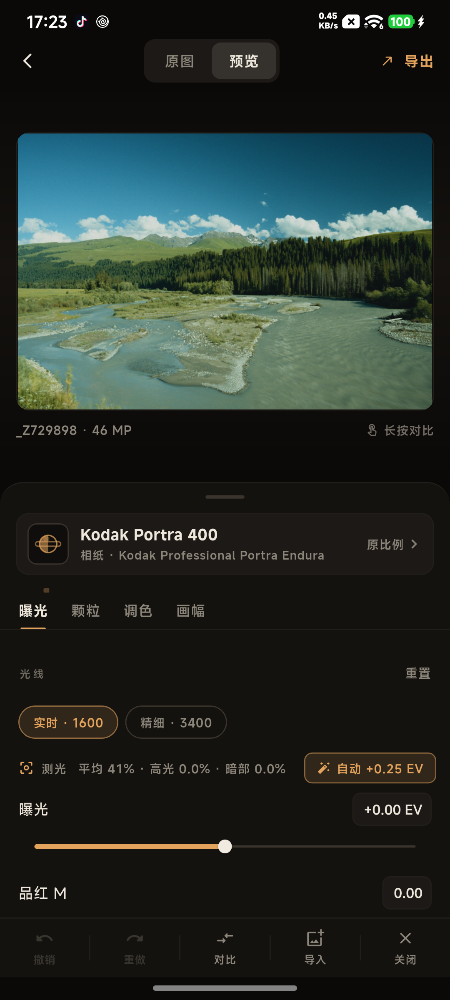
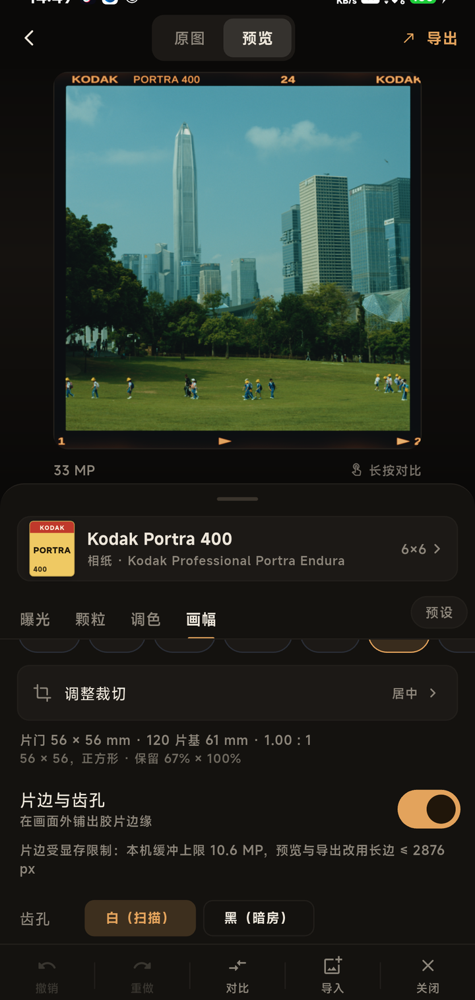

# 半档 / Halfstop

Android 上的胶片模拟应用。光谱计算和渲染都在手机 GPU 上跑，不联服务器，也不是套滤镜——胶片、相纸、放大机这一整套是算出来的。

| 编辑器 | 画幅、片边与日期后背 |
|---|---|
|  |  |
| Portra 400，测光给出 +0.25 EV | 6×6 与片边，边字按胶卷自带的版式 |

## 怎么用

挑一张照片，选胶片和相纸，划几下就出片。要用画幅就套一个，想更真实就开片边、打日期，最后导出 JPEG，拍摄参数跟着一起写进去。

调好一套之后存成预设，同一天剩下的照片直接套，不用每张重来。

## 功能

**胶片与相纸**

- 34 个 profile：25 款拍摄胶片、7 款相纸、2 款电影拷贝片
- 数据来自光谱实测，不是风格化的 LUT
- 彩色负片之外，黑白片也在：Ilford HP5 Plus、Kodak Tri-X 与 T-Max、Fujifilm Acros II
- 相纸决定纸基色调与反差，拷贝片走先翻底再印片的路子
- 放大机光源四种（KG3 冷光、KG3 加镜头、3200K、放映机），换灯时自动重算中性滤色
- 模拟强度可调，导出的 JPEG 按同一比例烘进去

**画幅与片边**

- 10 种画幅：135、半格、XPan、645、6×6、6×7、6×8、6×9、6×12、6×17
- 画幅框固定，双指缩放照片、单指拖动构图
- 片边：上下齿孔、片基外、边雾、漏光，条状或单张排布，图案可以重掷
- 画面水平翻转、垂直翻转、90° 旋转，外加 ±45° 内的任意角度微调
- 五种片门形状，边字可改写，可打帧号和光圈
- 半格画幅可以一格放两张
- 日期后背：三种字面、四角位置、字号、数据行，曝光深浅和离片门多远也能调

**调整**

- 曝光、品红与黄滤色、滤色强度，拖动时约 100 ms 出帧
- 测光读数与一键自动曝光
- 场景宽容度：高光与暗部各自往纸的范围里收，也可以按场景自动配
- 质感：镜头模糊、颗粒（含多层乳剂开关）、光晕（含高光溢出与余量）、眩光、散射、边缘效应
- 密度曲线 gamma：改的是银盐响应本身的陡度，不是拉伸像素
- 胶片宽度 4–200 mm：微米单位的效果（镜头模糊、颗粒、扩散）按它换算成像素；开了片边时改用片门自己的尺寸
- 调色五项：亮度、对比、饱和、色温、色调
- 直方图，可固定在面板顶部
- 撤销 20 步
- 每张照片记住自己的胶片、画幅、片边和调色，换照片不会串
- 预设：一整套设置存一条，下一张直接套

**导入与导出**

- 相册图片：JPEG、PNG、WebP、BMP
- RAW：ARW、DNG、CR2、CR3、NEF、RAF、ORF 等，走 LibRaw 解码
- 首页列出最近导入，RAW 的缩略图用相机内嵌的预览，不用先解码
- 多选批量导出：一套设置套到一组照片上，每张按自己的尺寸居中取景
- 导出 JPEG，EXIF 带完整的拍摄参数

## 已知限制

- 片边和日期要额外铺一块画布，本机显存够多少就算多大。超过上限时自动缩小长边，面板和导出结果里会写实际尺寸
- 对比度蒙版引擎在 Vulkan 后端还没实现，界面上没有这个开关

## 安装

从 [Releases](https://github.com/unnyXD/halfstop/releases) 下载 arm64 的 APK，Android 8.0 及以上。覆盖安装即可，导入缓存、预设和每张照片的设置都保留。

## 构建

需要 Flutter stable、JDK 17、Android SDK（platform 36）、NDK 28.2.13676358（要带 `glslc`）、CMake 3.22.1。

```powershell
# 工具链环境；或自行设置 SPK_TOOLCHAIN 指向含 flutter / jdk / android-sdk 的目录
. .\tool\env.ps1

# 拉引擎、编 shader（首次）
.\tool\fetch-engine.ps1
.\tool\build-shaders.ps1

# 打包
flutter build apk --release --target-platform android-arm64
adb install -r build\app\outputs\flutter-apk\app-release.apk
```

调试用 `flutter run --release`。单元测试用 `flutter test`。

## 架构

```
┌─ Flutter (Dart) ────────────────────────────────────────────┐
│  lib/editor_page.dart      编辑器：预览、滑块、胶片与相纸   │
│  lib/photo_settings.dart   每张照片的设置，按文件存          │
│  lib/presets.dart          具名的整套设置                    │
│  lib/engine_worker.dart    常驻 isolate：engine + session   │
│  lib/engine_bridge.dart    探针、一次性渲染、MethodChannel  │
│         │                                                   │
│         │  SendPort（命令 JSON / 像素 TransferableTypedData）│
│         ▼                                                   │
│  libspektrafilm.so                                          │
│  ├─ spk_mobile.cpp   探针与会话的 C ABI                     │
│  └─ engine/          spektrafilm core + pipeline + Vulkan   │
│         ├─ Vulkan compute（49 个 SPIR-V shader）            │
│         └─ assets/engine/** → filesDir/engine/**            │
└─────────────────────────────────────────────────────────────┘
```

引擎和 session 常驻在同一个 isolate，FFI 指针不跨 isolate；界面发 JSON 命令，像素用 `TransferableTypedData` 传回来，渲染不会堵住 UI。

引擎的参数走 JSON、像素走 buffer，所以加一个滑块不用改 FFI 签名。引擎本身不写文件，只返回 RGBA16，编码交给 Dart。调色那几项在 Flutter 侧用颜色矩阵做，不进引擎，滑块才跟得上手指。

场景宽容度是个例外：它不是一组能直接下发的参数，而是先让引擎按当前画面和相纸解算，再把算出来的曲线提交上去。

## 许可

- 引擎、胶片模型与 profile：**GPL-3.0-or-later**（上游 spektrafilm 项目），分发版本须以 GPLv3 开源
- 胶片与相纸 profile、打印 LUT：**CC BY-SA 4.0**
- 本移植代码同样按 **GPL-3.0-or-later** 发布
